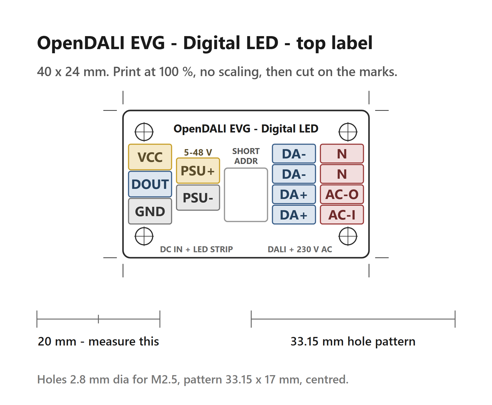

# LoadBoard 250W Digital LED

Addressable-LED driver and AC power switching board for WS2812 / SK6812 strips. Connects to the Controller via a 10-pin FFC cable (0.5 mm pitch, 25-50 mm, reverse) and provides:
- Mains switching for controlling the LED AC/DC power supply
- Power limits for the connected PSU: **max 1.2 A continuous** (without airflow), **max 3 A continuous** (with active airflow over the triac)
- One galvanically isolated single-wire data output
- **Strip supply 5 V … 24 V**, passed through from the PSU

Same AC stage as the [LoadBoard 250W RGBW](../DALI_Load_250W_RGBW/Readme.md). Firmware side: `EVG_MODE_WS2812`, `EVG_MODE_SK6812_RGB` or `EVG_MODE_SK6812_RGBW`.

## Controller signals

**Only `PWM_CH1` carries payload** — it is the single-wire data line (`PWM_CH1/D_LED/MOSI`, J4 pin 10, Controller PC6). Apart from that the board taps just `GND` (pin 1), `+3V3-PRI` (pin 2, supplies the isolator's input side) and `PSU-CTRL` (pin 6, switches the mains stage).

The remaining six — `SCK`, `SDA`, `SCL` and `PWM_CH2` … `PWM_CH4` — reach the connector but are left unconnected on this board. They stay available for a future revision.

## Connectors

| Ref | Type | Function |
|-----|------|----------|
| J1 | FFC 0.5 mm, 10-pin | Controller interface (Controller J4). `+3V3-PRI` here is the Controller's `+3V3-D`; `GND` is common to both. |
| P1 | KF142R-5.08, 4-pin | Mains in / switched mains out to the LED PSU |
| P7 | 1x4 header | DC input from the LED PSU (`PSU+` / `GND-SEC`) |
| P2 | KF2EDGR-3.81, 3-pin | LED strip: `PSU+`, `DATA`, `GND-SEC` |

> **⚠ Mains safety:** only screw this board into the enclosure with the housing part in place — the screw head must rest on plastic, never directly on the PCB. See [Enclosure](../README.md#enclosure).

## Top label

Print [`DALI_LOAD_DigitalLED_V0.2-TopLabel.png`](DALI_LOAD_DigitalLED_V0.2-TopLabel.png) at 100 %, cut on the marks and clamp the 40 x 24 mm plate under the four M2.5 screws on the enclosure top — the hole pattern is 33.15 x 17 mm.

## Strip supply

> ## `PSU+` = 5 V … 24 V
>
> `PSU+` is passed straight through from P7 to the strip connector, so **the strip runs at the PSU voltage — pick the PSU to match the strip.**

A local buck (ME3116) derives the 5 V that supplies the isolator's output side. It
still starts at `PSU+` = 5 V and delivers 4.44 V there — above the 3.5 V the strip
needs on its data line, so the whole input range is covered without an assembly
variant.

## Isolation

The data line crosses the barrier through a π110M30 single-channel digital isolator (3 kVrms) — input side powered from the controller's 3.3 V rail, output side from the local 5 V. Neither I²C nor a reverse channel crosses the barrier.

With the LED PSU off, the isolator's output side is unpowered and its output goes high-impedance. The π110M30 is the **Default Low** variant, so an absent input drives the strip line low (strip idle) rather than high.

> **⚠ Not fully IEC 62386 compliant:** the opto-triac that switches the mains stage is driven from the DALI bus. Bus current at 16 V: **1.67 mA** with the LED supply off (measured) and about **2.6 mA** for as long as it is on, so the 2 mA budget is exceeded continuously while the light is on. The 2.6 mA is an estimate for the IL4118 opto-triac and still has to be measured. The bus side is powered through a buck converter, so the current rises at lower bus voltage.

> **DALI side to LED side: supplementary insulation.** Separate from the mains barrier, which is reinforced (6.4 mm creepage, 4.0 mm clearance). DALI itself is **not SELV**: IEC 62386-101:2022 §4.9.2 classes the bus wiring and interface as **FELV**, with only basic insulation from mains, and FELV is not safe to touch. One failed device anywhere on the bus can therefore put mains potential on the DALI wires. NOTE 2 of the same clause asks for supplementary insulation, rated for 230 V AC, between the bus wiring and touchable conductive parts, which here means the LED side. The only part crossing that barrier is the digital isolator, rated 3 kVrms; the PCB keeps 2.5 mm between the two sides by design rule.
