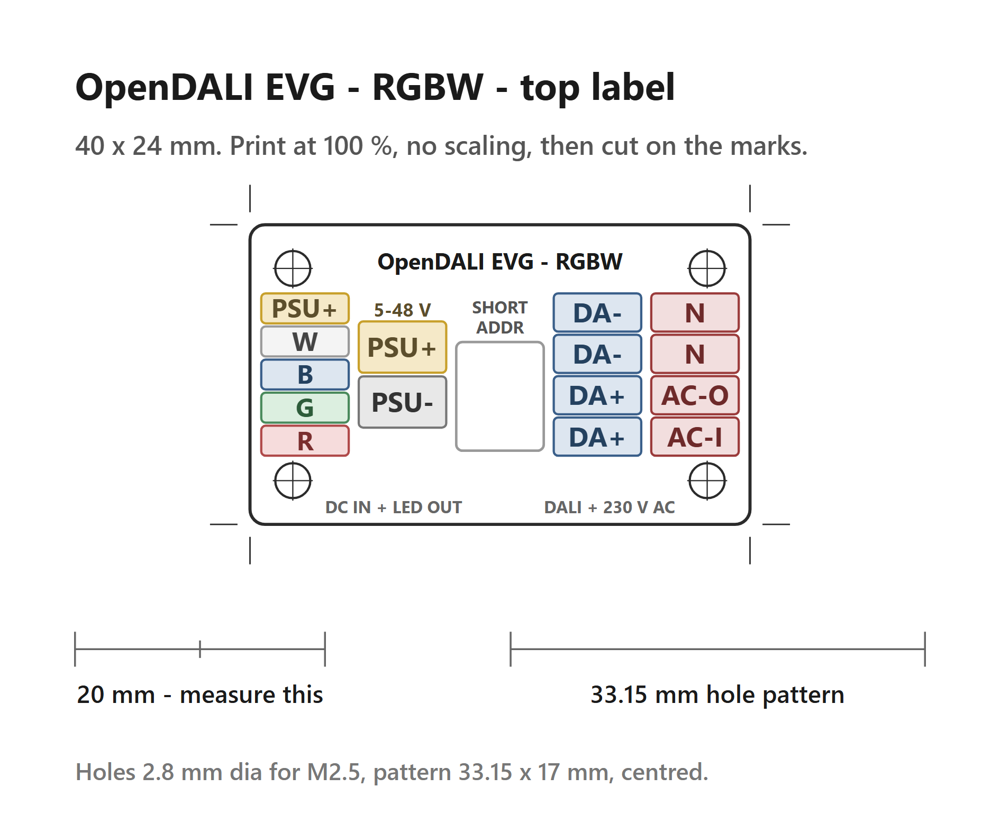

# LoadBoard 250W RGBW

LED driver and AC power switching board. Connects to the Controller via a 10-pin FFC cable (0.5 mm pitch, 25-50 mm, reverse) and provides:
- Mains switching for controlling the LED AC/DC Powersupply
- Power limits for the connected PSU: **max 1.2 A continuous** (without airflow), **max 3 A continuous** (with active airflow over the triac)
- 4-Channel PWM LED Driver (RGBW)

> **⚠ Work in progress.** This board is still under development.
>
> **⚠ Not fully IEC 62386 compliant:** the opto-triac that switches the mains stage is driven from the DALI bus. Measured bus current at 16 V: **1.67 mA** with the LED supply off and **3.9 mA** while it is on, against a budget of 2 mA. The bus side is powered through a buck converter, so the current rises at lower bus voltage.

> **DALI side to LED side: supplementary insulation.** Separate from the mains barrier, which is reinforced (6.4 mm creepage, 3.8 mm clearance). DALI itself is **not SELV**: IEC 62386-101:2022 §4.9.2 classes the bus wiring and interface as **FELV**, with only basic insulation from mains, and FELV is not safe to touch. One failed device anywhere on the bus can therefore put mains potential on the DALI wires. NOTE 2 of the same clause asks for supplementary insulation, rated for 230 V AC, between the bus wiring and touchable conductive parts, which here means the LED side. The only part crossing that barrier is the digital isolator, rated 3 kVrms.

> **⚠ Mains safety:** only screw this board into the enclosure with the housing part in place — the screw head must rest on plastic, never directly on the PCB. See [Enclosure](../README.md#enclosure).

## Top label

Print [`DALI_Load_250W_RGBW_V0.3-TopLabel.png`](DALI_Load_250W_RGBW_V0.3-TopLabel.png) at 100 %, cut on the marks and clamp the 40 x 24 mm plate under the four M2.5 screws on the enclosure top — the hole pattern is 33.15 x 17 mm.

